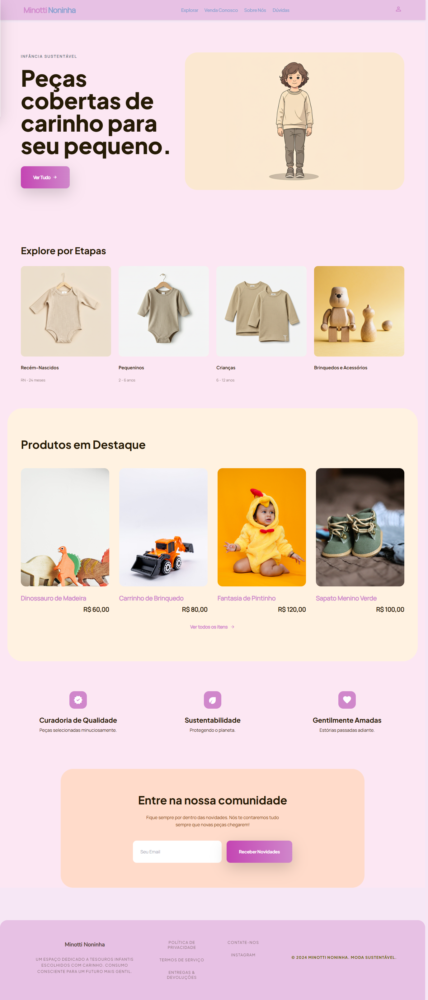
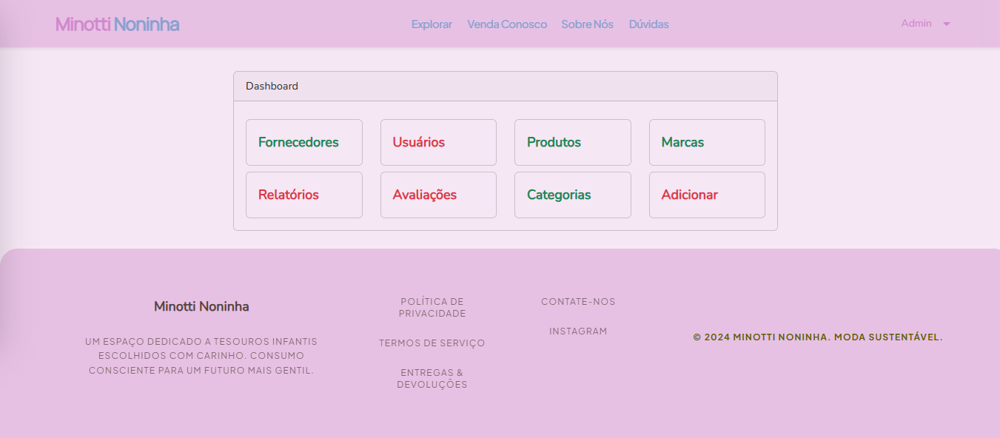
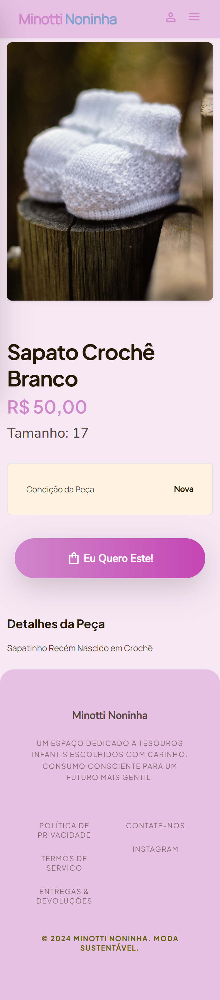

# Minotti

A thrift-store product catalog and administrative inventory system built with Laravel and Vue, with WhatsApp purchase inquiries. The application interface is in **Brazilian Portuguese**.

**Archived business project — no longer deployed.** Minotti was developed and deployed for a real thrift-store business that has since closed. Its former production infrastructure is inactive; this repository preserves the project for portfolio review and local exploration.

## Context and contribution

This was my first independently developed application after completing an Udemy course. As the solo developer of the original application, I implemented the storefront, inventory screens, database models, APIs, and authentication flow, and deployed it for the business.

The portfolio version retains that architecture, with focused correctness, authorization, and local-storage fixes. It demonstrates the work and tradeoffs of an early independent project; it is not a production-ready commerce platform. Purchases are handled through inquiries outside the application, rather than a cart, checkout, payment gateway, or order-management workflow. Additional reason being, the original purpose of the application was inventory control and elimination of physical paperwork, while allowing direct reservation via WhatsApp.

## Implemented features

**Storefront**

- Product catalog with name search, category, condition, and clothing/shoe-size filters, plus load-more pagination.
- Homepage clothing cards that open the catalog with an exact size filter: `RN`, `2`, or `6`.
- Featured available products and product details with price, condition, size, description, and image.
- WhatsApp inquiry-link generation, business information pages, and email subscription capture. Contact destinations in this portfolio copy are placeholders; subscription capture does not send campaigns.

**Administration**

- Product creation, viewing, editing, deletion, search, and pagination through `/produtos`.
- Brand, category, and supplier management, including searchable relationship selectors.
- Available, sold, and pending inventory statuses; item labels; supplier ownership; division type and store-share fields for consignment inventory.
- Product image upload, replacement, and deletion using Laravel's public disk.
- Administrator checks for dashboard pages and administrative APIs; public registration is disabled.

## Preview

Actual application captures from the repository. The catalog shown in these images is not automatically recreated by the supplied seeders.

| Homepage — desktop | Dashboard Home — desktop |
| --- | --- |
| <a href="docs/screenshots/1-homepage.png"></a> | <a href="docs/screenshots/1-homepage.png"></a>

More desktop views: [single product](docs/screenshots/3-single_product.png), [catalog](docs/screenshots/2-catalogue.png), [catalog filters](docs/screenshots/2-catalogue_filter_on.png).

<details>
<summary>Mobile views</summary>

| Catalog | Product details |
| --- | --- |
| <a href="docs/screenshots/2-catalogue_mobile.png"></a> | <a href="docs/screenshots/3-single_product_mobile.png"></a> |

</details>

## Technology and technical highlights

| Area | Implementation |
| --- | --- |
| Backend | PHP 8.2+, Laravel 11; framework locked to 11.34.2 |
| Frontend | Vue 3, Vuex 4, Axios, Blade templates |
| Styling and assets | Bootstrap 5, Tailwind CSS 3, Sass, Vite 5 |
| Database | Eloquent ORM and migrations; MySQL in the example environment |
| Authentication | Laravel UI session login and `tymon/jwt-auth` Bearer tokens |
| Checks | PHPUnit 11 and Node's built-in test runner with Vue compilation/rendering tests |

The implementation includes relational inventory modeling, monetary values stored as integer cents, a dedicated public product resource that excludes internal supplier/share fields, allowlisted administrative query selections and filters, and reusable tables, modals, selectors, and pagination components.

See [the architecture overview](docs/architecture.md) for request flow, relationships, authentication boundaries, and tradeoffs.

## Run locally

### 1. Requirements and dependencies

Use PHP 8.2+ with Laravel's required extensions and `pdo_mysql`, Composer, MySQL, and a Node.js version compatible with Vite 5 (`^18.0.0` or `>=20.0.0`) with npm. PHP's `pdo_sqlite` extension is also needed for the automated PHP tests. This repository preserves the original implementation. Local setup requires synthetic inventory and image assets, which are not bundled with the source.

From the cloned repository directory:

```sh
composer install
npm ci
php -r "file_exists('.env') || copy('.env.example', '.env');"
```

### 2. Environment and database

Create an empty, dedicated local MySQL database named `minotti`. Edit `.env` to use your own local database connection:

```dotenv
APP_ENV=local
APP_URL=http://127.0.0.1:8000
DB_CONNECTION=mysql
DB_HOST=127.0.0.1
DB_PORT=3306
DB_DATABASE=minotti
DB_USERNAME=your_local_database_user
DB_PASSWORD=your_local_database_password
```

Generate independent local application and JWT secrets, then create the database tables:

```sh
php artisan key:generate
php artisan jwt:secret
php artisan migrate
```

`jwt:secret` adds `JWT_SECRET` to `.env`; it is not present in the current example file. Keep `.env` and generated secrets out of Git. The example environment uses database-backed sessions and cache, whose tables are included in the migrations.

### 3. Reference data and local administrator

The default `DatabaseSeeder` does not create records. On a fresh database, run the reference seeders once:

```sh
php artisan db:seed --class=CategoriasBaseSeeder
php artisan db:seed --class=RoupaSeeder
php artisan db:seed --class=CalcadoSeeder
```

These seeders insert records and are not idempotent. The application expects category IDs `1 = Outros`, `2 = Calçados`, and `3 = Roupas`, which their insertion order supplies on an empty database.

Public registration is disabled. Create your own local administrator with `php artisan tinker`, replacing the password placeholder before running:

```php
App\Models\User::create([
    'nome' => 'Local Admin',
    'email' => 'admin@example.test',
    'password' => 'replace-with-a-local-demo-password',
    'role' => 'admin',
]);
```

The user model hashes the password. An `AdminSeeder` also exists but is not called by the default seeder; the example above lets you choose your own local identity and password.

### 4. Images and synthetic inventory

```sh
php artisan storage:link
```

Product images are stored in `storage/app/public/imagens/produtos` and served through `/storage/imagens/produtos/...`. Product operations explicitly use the `public` disk, so changing `FILESYSTEM_DISK` globally is unnecessary. Database image values must remain relative paths such as `imagens/produtos/example.jpg`.

If `public/storage` already exists as an ordinary directory, inspect and preserve its files before replacing it with the standard link. On Windows, Laravel may create a directory junction.

Uploaded files and the local database are gitignored. No complete synthetic inventory or image fixture set is supplied. To populate a fresh installation:

1. After starting the application, sign in and create synthetic brands and suppliers through the dashboard. Reserve the first brand and supplier (ID `1`) as the store/fallback records expected by deletion logic.
2. Use synthetic supplier identity, address, contact, and payment-key values that satisfy the form rules. Do not import former business/customer data.
3. Add products through `/produtos`, with locally available PNG/JPEG images, and mark products `disponivel` to show them publicly. Featured products fall back to other available items.

For the decorative homepage images, provide permitted assets under `storage/app/public/imagens/frontpage/`: `frontpagemodel.png` and `frontpage-category-1.png` through `frontpage-category-4.png`. These storage assets are also gitignored. The screenshot files document the interface; they are not upload fixtures.

### 5. Start the application

Run these commands in separate terminals:

```sh
php artisan serve --host=127.0.0.1 --port=8000
```

```sh
npm run dev
```

Open <http://127.0.0.1:8000>. Log in at `/login`; inventory is at `/produtos`. Use this exact host and port because several existing frontend API URLs are hardcoded to it. `npm run build` is available for compiled assets instead of the Vite development server; avoid a stale `public/hot` file when using a build.

AWS credentials and the former S3-compatible service are not required for the current product-image flow. Some information pages still use remote images and fonts.

## Automated checks

```sh
php vendor/phpunit/phpunit/phpunit --do-not-cache-result
node --test tests/Frontend/*.test.cjs
```

The tests cover administrator boundaries, query validation, featured-product edge cases, login handoff, image lifecycle behavior, component rendering, and homepage-to-catalog navigation. PHP tests use in-memory SQLite; image mutation tests use disposable synthetic records and fake storage. They do not establish a fully tested fresh MySQL installation or end-to-end browser coverage.

## Known scope and limitations

- No cart, checkout, payment processing, or order-management workflow is implemented.
- User management, reports, reviews, and the newer `/adicionar` entry screen are unfinished. Use the product-management screen for inventory entry.
- The WhatsApp destination is a placeholder; its message still uses a dashboard-style product path and an unformatted stored price. It is not a live sales channel in this copy.
- The toys/accessories homepage card remains unfiltered. Clothing cards select one exact size, not every size in the displayed range.
- A fresh clone requires manual synthetic inventory and asset provisioning; screenshots show an already populated local installation.
- Session and JWT logout are separate paths. Existing security and validation limitations are described in the [architecture overview](docs/architecture.md#boundaries-and-limitations); this is a local portfolio application, not a deployment-ready release.

The original business is closed and **there is no active hosted application**. No standalone project license file is included.
