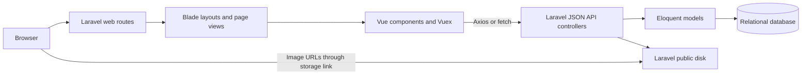

# Minotti architecture

[Back to README](../README.md)

This describes the current portfolio source, including the focused authorization, query-validation, local-image, and catalog-navigation corrections. The original application was independently developed for a thrift-store business that has since closed. Historical deployment does not imply that every current portfolio change ran in production.

## Application structure

Minotti is a **Laravel monolith with Blade pages and embedded Vue components**. Laravel serves both HTML and JSON APIs. There is no Vue Router or Inertia layer: links navigate between Laravel routes, and Vue loads the data needed inside each page.

The database and public disk are parts of this application deployment, not separate application services. MySQL is selected by `.env.example`; automated PHP tests use SQLite in memory.

| Location | Responsibility |
| --- | --- |
| [`routes/web.php`](../routes/web.php) | Public pages, session login routes, and dashboard pages |
| [`routes/api.php`](../routes/api.php) | Public catalog endpoints, administrative resources, and JWT endpoints |
| [`resources/views`](../resources/views) | Blade layout and component mounting points |
| [`resources/js/app.js`](../resources/js/app.js) | Vue component registration and Vuex store |
| [`app/Http/Controllers`](../app/Http/Controllers) | Query coordination, validation calls, persistence, and responses |
| [`app/Models`](../app/Models) | Eloquent relationships, fillable attributes, and most domain validation rules |
| [`app/Repositories`](../app/Repositories) | Shared administrative filtering, selection, and pagination |

Vite compiles Vue and Sass. The Sass entry imports Bootstrap and the Tailwind-backed application CSS. Both styling systems remain in use. Echo/Pusher and queue-related dependencies/configuration exist, but do not establish implemented real-time inventory, notification, or campaign features.

## Frontend state and requests

The Vuex store contains `item`, `activeItem`, and `transacao`. Administrative tables select records; view/edit modals consume their data and transaction feedback. `setActiveItem` initializes relationship objects, although several components also write store state directly. State is recreated with each Blade-page navigation; Vuex is not persistent inventory storage or the source of authorization decisions.

[`bootstrap.js`](../resources/js/bootstrap.js) installs an Axios interceptor that requests JSON and copies the JWT cookie into an `Authorization: Bearer ...` header. Login uses `fetch` separately. Product forms use `FormData` and Laravel's `_method` override for multipart PATCH/DELETE requests.

For the catalog:

1. `/vitrine` serves a Blade view mounting [`AllProducts.vue`](../resources/js/components/AllProductsPage/AllProducts.vue).
2. The component initializes supported `idade` and `categoria` values from the URL, then requests `/api/v1/vitrine`.
3. Search/filter changes trigger a debounced reload. Load-more appends the next page while preserving filters.
4. The controller returns only available products through `ProdutoResource`.

The homepage derives an exact size from the first subtitle segment. For example, `2 - 6 anos` links to `/vitrine?idade=2&categoria=3`. The label describes an age group, but the implemented filter is equality against the product's stored `tamanho`; it is not a range query. The toys/accessories card has no mapped category and opens the unfiltered catalog.

## API boundaries

All paths below include Laravel's `/api` prefix.

| Endpoints | Access and response |
| --- | --- |
| `GET /api/v1/vitrine` | Public; six products per page with resource pagination metadata |
| `GET /api/v1/vitrine/{id}` | Public; one available product, or 404 |
| `GET /api/v1/destaque` | Public; up to four available featured products, filled from available non-featured products when needed |
| `GET /api/categorias/publiclist` | Public; category IDs and names |
| `POST /api/subscribers` | Public; validates and stores a unique email, returning confirmation |
| `/api/v1/produtos`, `/api/v1/marcas`, `/api/v1/categorias`, `/api/v1/fornecedores` | JWT plus administrator role; resource CRUD endpoints |
| Administrative `/api/v1/opcoes/*`, `*/list`, and size endpoints | JWT plus administrator role; form options/search results |
| `POST /api/login` | Credentials exchanged for a JWT; token issuance itself does not require the administrator role |
| `POST /api/v1/me`, `/api/v1/refresh`, `/api/v1/logout` | JWT authentication; outside the administrator-only group |
| `GET /api/user` | Separate Sanctum-protected scaffold endpoint; not the demonstrated dashboard authentication path |

[`ProdutoResource`](../app/Http/Resources/ProdutoResource.php) explicitly exposes `id`, `nome`, `valor_venda`, `imagem`, `categoria`, `tamanho`, `descricao`, and `condicao`. `imagem` is a browser URL. Supplier identity, store share, and supplier/brand foreign keys are not included in that public resource.

Administrative product listings return Eloquent pagination directly, with four records per page; detail responses also load brand, supplier, and category relationships. Their `imagem` remains a relative storage path. This gives the dashboard operational data, including supplier fields on product details, rather than the restricted storefront representation.

[`AbstractRepository`](../app/Repositories/AbstractRepository.php) accepts comma-separated `atributos` and semicolon-separated `campo:operador:valor` filters. Each concrete repository defines allowed fields. Unsupported fields, operators, or malformed input produce validation errors. Selection uses `select()`, and filter values use query bindings. This preserves the original query format without accepting request-provided SQL expressions.

## Authentication and authorization

The application implements two authentication mechanisms together: 

1. [`Login.vue`](../resources/js/components/Login.vue) posts email/password to `/api/login`.
2. On success it stores the JWT in a JavaScript-accessible cookie with `SameSite=Lax`.
3. It submits the existing CSRF-protected Laravel login form to establish a web session.
4. Dashboard page requests use session authentication. Subsequent Axios API calls attach the JWT as a Bearer token.

[`config/auth.php`](../config/auth.php) defines the `web` session guard and `api` JWT guard. [`User`](../app/Models/User.php) implements `JWTSubject`, hashes passwords through a cast, and hides password/remember-token values from serialization. JWT signing, TTL, refresh window, and blacklist settings are defined in [`config/jwt.php`](../config/jwt.php).

[`EnsureUserIsAdmin`](../app/Http/Middleware/EnsureUserIsAdmin.php) checks `role === 'admin'` using the requested guard. Dashboard routes use `auth` plus `admin:web` (including `/home` through its controller); administrative API routes use the JWT package's `jwt.auth` plus `admin:api`. A web administrator session does not substitute for an administrator JWT identity. Registration routes are disabled. There is no permission matrix, per-record ownership policy, or tenant model.

Token lifecycle endpoints remain outside the role check so their authentication behavior is separate from administrative permissions. However, `/me` currently calls the default guard rather than explicitly selecting `api`. The visible logout form submits session logout; it does not coordinate JWT revocation and cookie removal. These remain implementation limitations, not a single unified logout contract.

## Data model and consignment inventory

| Model | Stored purpose and relationships |
| --- | --- |
| `Produto` | Belongs to `Categoria`, `Marca`, and `Fornecedor`; holds item label, description, image path, size, condition, price, store share, status, and featured flag |
| `Categoria` | Has many products |
| `Marca` | Has many products |
| `Fornecedor` | Has many products; stores supplier identity, address, phone, and Pix-key fields |
| `Tamanho` | Clothing/shoe option records; products store size text, with no foreign key to this model |
| `User` | Login identity and role; not linked to customer orders or product ownership |
| `Subscriber` | Unique newsletter email; no delivery/campaign relationship |

Product migrations define foreign keys for category, brand, and supplier. Current monetary columns are integers representing cents: `1000` means R$10.00. The frontend formats them as Brazilian real values. `parte_loja` is the stored monetary share for the store; `tipo_divisao` records `fixo` or `percentual`. These fields model consignment inventory but do not implement supplier settlements, payment execution, or a financial ledger. The current main product form calculates a percentage share if the `percentual` option is chosen, starting from 10% to 50% (business rule) set at item inclusion.

Inventory status is `pendente`, `disponivel`, or `vendido`. Catalog and public detail endpoints require `disponivel`; featured selection applies the same restriction and returns fewer than four when necessary.

Deleting brands or suppliers reassigns their products to record ID `1`; deleting a non-reserved category reassigns products to category `1`. Category IDs `1`, `2`, and `3` are protected, and the UI associates `2` with shoes and `3` with clothing. These conventions make initial record creation significant. Reassignment and parent deletion are not wrapped in a transaction, so this is a pragmatic fallback mechanism rather than a fully transactional workflow.

## Product images

[`ProdutoController`](../app/Http/Controllers/ProdutoController.php) and `ProdutoResource` explicitly use `Storage::disk('public')`, independently of the global default disk.

| Layer | Example |
| --- | --- |
| Database `imagem` | `imagens/produtos/example.jpg` |
| Physical file | `storage/app/public/imagens/produtos/example.jpg` |
| Public URL | `/storage/imagens/produtos/example.jpg` |
| Link | `public/storage` points to `storage/app/public` |

The public disk URL is root-relative in [`filesystems.php`](../config/filesystems.php), avoiding a dependency on a particular local port. Storefront components use the resource URL directly. The administrative API keeps the relative path; [`Produtos.vue`](../resources/js/components/Produtos.vue) supplies `/storage/` to its table and uses the same prefix in existing-image modals.

Creation requires a PNG/JPEG upload. Replacement is optional during editing: the controller stores the new file, saves its relative path, and then removes the previous public file. If persistence throws, it removes the new upload and retains the original file. Deletion removes the record before its public image, preserving the image when record deletion fails. Database and filesystem operations are not an atomic transaction, and filesystem cleanup can still fail independently.

The S3 adapter and configuration remain from the hosted implementation, but the current product-image operations do not use them. Uploads, decorative storage assets, local databases, and generated build files are gitignored. A fresh clone needs the asset/reference-data provisioning described in the [README](../README.md#run-locally); screenshots are not a database or upload backup.

## Boundaries and limitations

- This is a catalog and inventory system with external purchase inquiries. There are no order, cart, payment, or shipment models/workflows.
- Users, reports, reviews, and the newer `/adicionar` screen remain incomplete. The established `/produtos` screen is the inventory workflow.
- Newsletter capture stores emails only. WhatsApp/contact destinations are placeholders; the generated product message still has an incorrect product path and raw cent value.
- The session/JWT combination requires two successful login steps and has separate logout behavior. The JWT cookie is accessible to JavaScript and has no explicit expiration attribute in the login component.
- No explicit rate limits were added to the JWT login or subscriber endpoints; CORS remains permissive. Current role checks and query validation should not be read as a claim of comprehensive security hardening.
- Validation rules mostly live in models and are reused by controllers. Some rule/schema lengths differ, the product-label uniqueness rule is malformed, and full-update paths sometimes validate against an uninitialized model rather than the loaded record. Registration/factory scaffolding also retains a `name` versus `nome` mismatch.
- Several API URLs assume 'http://127.0.0.1:8000'. Changes occurred when hardcoding from production code. Remote informational imagery and fonts depend on external availability. The dashboard table uses horizontal overflow on narrow screens.
- Automated tests cover selected API and component behaviors with disposable data. They do not demonstrate MySQL-specific migration compatibility, complete browser interaction coverage, load capacity, or production readiness.

The architecture intentionally preserves the original application's shape. Further deployment hardening, complete demo fixtures, or completion of placeholder features would be separate work rather than documentation changes.
